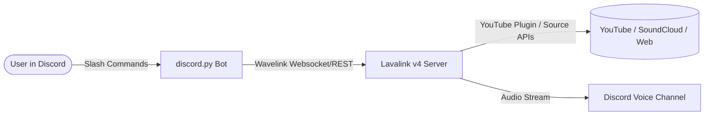

<div align="center">

# 🎵 Discord Music Bot

An asynchronous, feature-rich Discord music bot built with **discord.py**, **Wavelink (v3)**, and **Lavalink v4**.

[](https://www.python.org/)
[](https://github.com/Rapptz/discord.py)
[](https://github.com/PythonistaGuild/Wavelink)
[](https://github.com/lavalink-devs/Lavalink)
[](LICENSE)

<p align="center">
  <a href="#-features">Features</a> •
  <a href="#-architecture">Architecture</a> •
  <a href="#-prerequisites">Prerequisites</a> •
  <a href="#-installation--setup">Installation</a> •
  <a href="#-running-the-bot">Running</a> •
  <a href="#-slash-commands">Commands</a> •
  <a href="#-troubleshooting">Troubleshooting</a>
</p>

</div>

---

## ✨ Features

- 🚀 **High Performance Audio**: Standalone audio encoding & streaming powered by Lavalink v4.
- 🔎 **Multi-Platform Search & Playlists**: Search songs or provide direct URLs from YouTube, SoundCloud, Bandcamp, Twitch, and more.
- ⚡ **Native Slash Commands**: Full Discord application command tree support with interactive parameter options and autocomplete.
- 🔁 **Flexible Loop Modes**: Toggle between Single Track Loop (`track`), Entire Queue Loop (`queue`), or normal playback (`off`).
- 🔊 **Fine-Grained Volume Control**: Real-time volume scaling from 0% to 100%.
- 📜 **Queue Management**: Inspect upcoming tracks and real-time playback state.
- 🛠️ **Fast Guild Syncing**: Instant slash command synchronization for testing guilds.

---

## 🏗️ Architecture



---

## 📋 Prerequisites

Before setting up the bot, ensure you have:

1. **Python 3.10+**: Download from [python.org](https://www.python.org/downloads/).
2. **Java 17 or 21 (JDK/JRE)**: Required to run `Lavalink.jar` (e.g., [Eclipse Temurin](https://adoptium.net/)).
3. **Discord Bot Account**:
   - Create an application at [Discord Developer Portal](https://discord.com/developers/applications).
   - Under the **Bot** tab, enable:
     - ✅ **Message Content Intent**
     - ✅ **Server Members Intent** (Optional)
   - Generate your **Bot Token** and save it.

---

## 🚀 Installation & Setup

### 1. Clone the Repository
```bash
git clone https://github.com/your-username/bot-discord.git
cd bot-discord
```

### 2. Create and Activate a Virtual Environment

**Windows (PowerShell):**
```powershell
python -m venv venv
.\venv\Scripts\Activate.ps1
```

**Windows (Command Prompt):**
```cmd
python -m venv venv
.\venv\Scripts\activate.bat
```

**Linux / macOS:**
```bash
python3 -m venv venv
source venv/bin/activate
```

### 3. Install Dependencies
```bash
pip install -r requirements.txt
```

### 4. Configure Environment Variables
Copy `.env.example` to `.env`:

```bash
cp .env.example .env
```

Open `.env` and fill in your credentials:

```env
# Discord Bot Token (Required)
TOKEN=your_discord_bot_token_here

# Guild ID for instant slash command syncing during development (Optional: leave blank for global sync)
GUILD_ID=Your ID Discord Server

# Lavalink Node Configuration
LAVALINK_URI=http://127.0.0.1:2333
LAVALINK_PASSWORD=Your password in application.yml
```

---

## 🏃 Running the Bot

Running the bot requires **two terminal instances** (one for Lavalink and one for the Python bot):

### Step 1: Start the Lavalink Server
```bash
java -Xmx2G -jar Lavalink.jar
```
> [!NOTE]
> Wait until the log displays: `Lavalink is ready to accept connections.`

### Step 2: Start the Discord Bot
In a new terminal window (with virtual environment activated):
```bash
python main.py
```

---

## 🎮 Slash Commands

| Command | Parameter(s) | Description |
| :--- | :--- | :--- |
| `/play` | `query: <string>` | Search track title or paste a direct URL (YouTube / SoundCloud / Playlist) |
| `/pause` | — | Pause the current song |
| `/resume` | — | Resume paused playback |
| `/skip` | — | Skip the current track |
| `/stop` | — | Stop music, clear queue, and leave the voice channel |
| `/queue` | — | Display upcoming tracks and current loop mode |
| `/nowplaying` | — | Show detailed info about the active track |
| `/loop` | `mode: <off \| track \| queue>` | Configure loop settings (`off`, `track`, or `queue`) |
| `/volume` | `level: <0-100>` | Adjust player volume level |

---

## 📂 Project Structure

```text
bot-discord/
├── cogs/
│   └── music.py          # Music cog handling Wavelink events, audio nodes & slash commands
├── application.yml       # Lavalink configuration & YouTube plugin settings
├── Lavalink.jar          # Lavalink v4 server binary
├── main.py               # Main bot initialization & slash tree sync
├── requirements.txt      # Python dependencies list
├── .env.example          # Environment variable template
├── .gitignore            # Git ignore list
└── README.md             # Project documentation
```

---

## ⚙️ Configuration & Customization

### Lavalink `application.yml`
The Lavalink server configuration is stored in `application.yml`:
- **Port**: Default is `2333`
- **Password**: Default is `Aru1234`
- **Plugins**: Includes `dev.lavalink.youtube:youtube-plugin` to bypass YouTube rate limits and playback restrictions.

### Command Synchronization
- **Guild Sync (`GUILD_ID` specified)**: Slash commands sync instantly to your test server.
- **Global Sync (`GUILD_ID` left blank)**: Commands sync globally across all servers the bot is in (may take up to an hour to propagate).

---

## ❓ Troubleshooting

<details>
<summary><b>1. Lavalink fails with <code>UnsupportedClassVersionError</code></b></summary>
Lavalink v4 requires <b>Java 17 or Java 21</b>. Check your Java version using:
```bash
java -version
```
</details>

<details>
<summary><b>2. Slash commands do not appear in Discord</b></summary>
Ensure you have invited the bot with the <code>applications.commands</code> OAuth2 scope and set your server's <code>GUILD_ID</code> in <code>.env</code> for instant command registration.
</details>

<details>
<summary><b>3. Bot connects to voice but no audio is heard</b></summary>
Verify that PyNaCl is properly installed (<code>pip install PyNaCl</code>) and that the Lavalink node shows connected in the bot terminal logs.
</details>

---

## 🤝 Contributing

Contributions, issues, and feature requests are welcome!
Feel free to check the [issues page](https://github.com/your-username/bot-discord/issues).

---

## 📄 License

This project is licensed under the [MIT License](LICENSE).
